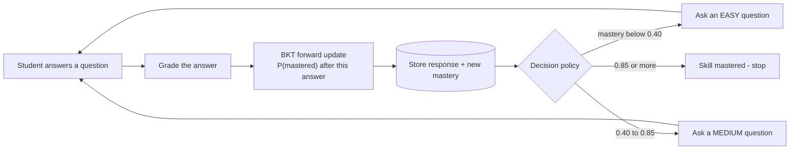
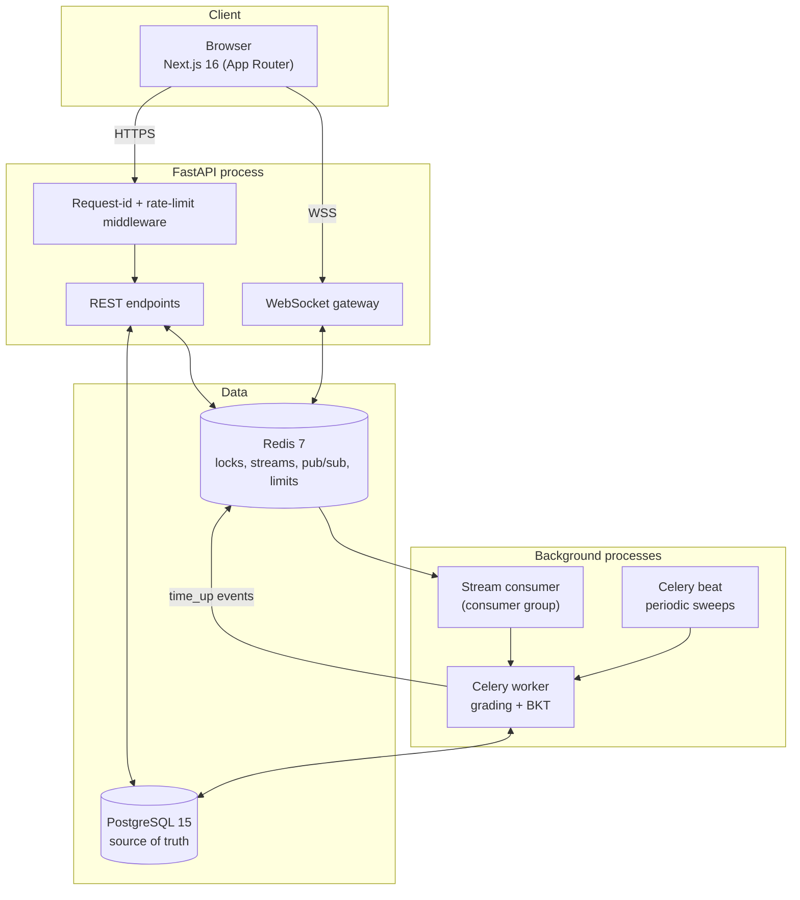
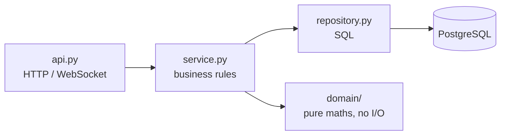
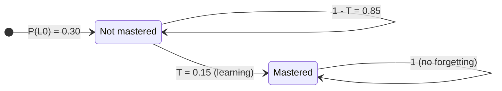
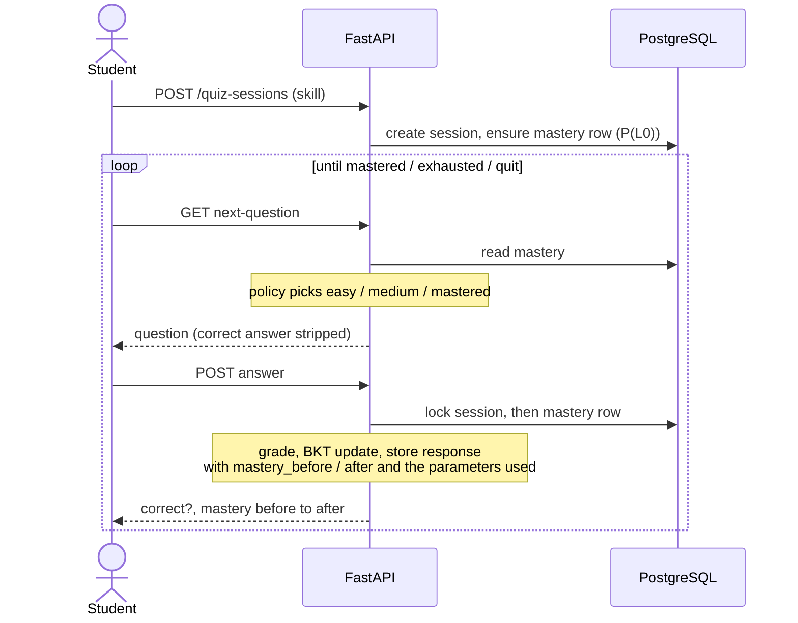
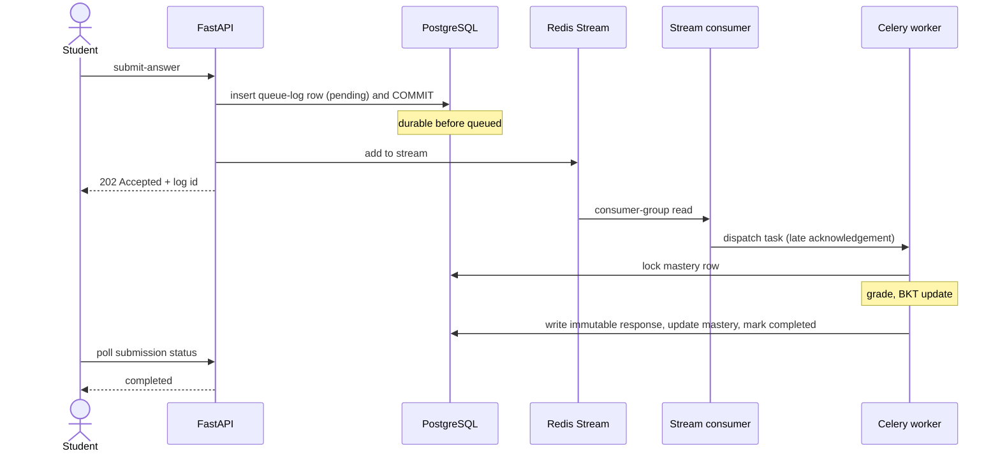
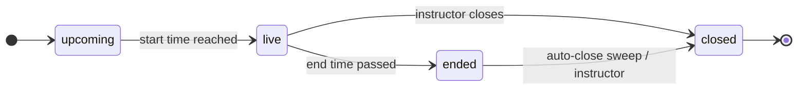
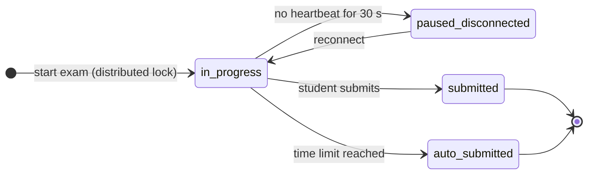
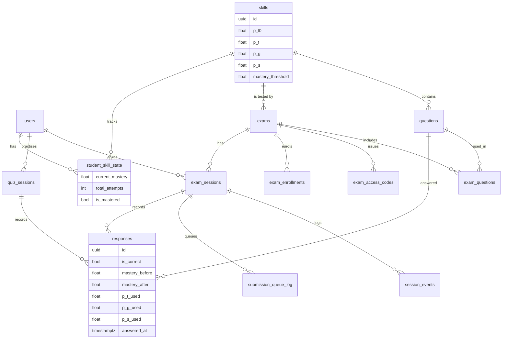

# SkillTrace

**An adaptive practice and timed-exam platform that measures what a student actually knows — using Bayesian Knowledge Tracing (BKT), a probabilistic model of mastery — built on a durable, concurrency-safe distributed backend.**

[](https://github.com/im-rk/SkillTrace/actions/workflows/ci.yml)
    

> Course project for **22AIE301 – Probabilistic Reasoning** (Group 3). The probabilistic core (a two-state Hidden Markov Model) is implemented **from scratch, with no ML library**, then wrapped in a production-style platform.

---

## Table of contents

1. [The problem](#1-the-problem)
2. [What SkillTrace does](#2-what-skilltrace-does)
3. [Feature overview](#3-feature-overview)
4. [System architecture](#4-system-architecture)
5. [The probabilistic core: BKT](#5-the-probabilistic-core-bkt)
6. [How the main flows work](#6-how-the-main-flows-work)
7. [Data model](#7-data-model)
8. [Reliability and correctness engineering](#8-reliability-and-correctness-engineering)
9. [Instructor analytics](#9-instructor-analytics)
10. [API overview](#10-api-overview)
11. [Frontend](#11-frontend)
12. [Testing and verification](#12-testing-and-verification)
13. [Project structure](#13-project-structure)
14. [Getting started](#14-getting-started)
15. [Configuration](#15-configuration)
16. [Known limitations and roadmap](#16-known-limitations-and-roadmap)
17. [Tech stack](#17-tech-stack)

---

## 1. The problem

A quiz score such as "7 / 10" is a poor description of knowledge:

- A **correct** answer may be a lucky *guess*; a **wrong** answer may be a careless *slip*. A score cannot tell them apart.
- Instructors need to know **which skill** is weak, not just how many questions were missed.
- Every student gets the **same questions**, so strong students are bored and weak students are discouraged.
- Real exam systems fail in specific ways: the **thundering herd** when the timer hits zero, answers lost when a worker dies, double submissions, unfair timers, and mastery numbers that nobody can explain afterwards.

SkillTrace attacks both halves: a **probabilistic model** that turns answers into a *probability of mastery*, and an **engineering design** in which that probability is trustworthy, auditable and reproducible.

---

## 2. What SkillTrace does



The same mastery number is used in two modes:

- **Adaptive free practice** — difficulty follows the student's current mastery until the skill is mastered.
- **Timed exams** — instructors schedule an exam, students take it under a server-controlled clock, and every exam answer updates the same mastery chain.

---

## 3. Feature overview

### Students
| Feature | Details |
|---|---|
| Registration / login | JWT in an **httpOnly cookie**; students self-register, instructors are created out of band |
| **Adaptive practice** | Pick a skill → questions adapt (easy / medium) to the live mastery estimate; ends when mastery ≥ threshold, questions run out, or the student quits; sessions can be resumed |
| **Live mastery gauge** | Shows the probability of mastery before/after every answer, with the goal marker |
| **Progress chart** | Mastery after every answer, goal line, and a **"Likely mastered here"** marker computed with the Viterbi algorithm |
| **Join an exam** | Redeem an **access code** (rate limited) to enrol |
| **Timed exam** | Server-synchronised countdown over a **WebSocket**, one attempt, answers are final once submitted, "Answer recorded" when the worker has graded, auto-submit with a pushed "time is up" |
| Results | Own score, answers and mastery after the exam closes |

### Instructors
| Feature | Details |
|---|---|
| **Skills** | Create / edit / soft-delete skills; edit the four BKT parameters (P(L0), P(T), P(G), P(S)) and the mastery threshold per skill (validated to [0, 1]) |
| **Readiness check** | A skill is "ready" for adaptive practice only if it has questions in all three difficulty tiers |
| **Class mastery table** | Every student's current mastery, attempts and mastered flag per skill |
| **Question bank** | Multiple-choice, true/false and text-input questions with difficulty and tags; **bulk import** from CSV/JSON with a per-row success/failure report (API) |
| **AI question drafting** | "Generate with AI" asks an LLM (Groq) for draft questions for a skill; every draft is schema-validated, shown for **instructor review**, and only the ticked ones are saved (tagged `ai-generated`) |
| **Exams** | Create with a start/end window and duration, assign ordered questions with points, generate **access codes** (max uses, expiry), close manually; expired exams are closed automatically |
| **Results & analytics** | Per-student score and mastery, **item analysis** (difficulty and discrimination of every question), per-session **audit trail** |

### Operations / platform
| Feature | Details |
|---|---|
| Observability | `/admin/metrics` (queue depth, lock contention, WebSocket connections); a **request id** traced through API → queue → worker logs |
| Rate limiting | Redis fixed-window limiter: global per user/IP, access-code redemption, login/register; fails open if Redis is down |
| Disaster recovery | Rebuild any student's mastery from the immutable answer log; rebuild the results materialized view |
| CI | GitHub Actions: backend tests against real PostgreSQL + Redis, frontend lint + build |

---

## 4. System architecture



**Modular monolith.** One backend codebase split into nine domain modules, each with the same layers:



| Module | Responsibility |
|---|---|
| `iam` | Register, login, logout, JWT cookie, roles |
| `question_bank` | Question CRUD (3 types), tags, bulk import |
| `quiz_engine` | **BKT engine**, skills, free practice, mastery, progress, mastery recompute |
| `scheduling` | Exams, assigning questions, derived phase, start with a distributed lock, auto-close |
| `enrollment` | Access codes, redemption, enrolments |
| `live_session_gateway` | Exam sessions, WebSocket, heartbeats, pause/resume events, auto-submit |
| `evaluation_pipeline` | Durable submission pipeline: queue → stream → Celery → grade → update mastery |
| `results` | Results, **item analysis**, audit trail, materialized view refresh |
| `observability` | Metrics endpoint |

Runtime processes (Docker Compose): `postgres`, `redis`, `backend` (API), `worker`, `beat`, `stream_consumer`, and the Next.js frontend. A production variant with an nginx reverse proxy is provided as configuration (not deployed).

---

## 5. The probabilistic core: BKT

### 5.1 The model

Bayesian Knowledge Tracing (Corbett & Anderson, 1994) treats a student's knowledge of **one skill** as a **hidden two-state variable** — *mastered* or *not mastered* — which can only be observed indirectly through answers. That is a **Hidden Markov Model**.



| Hidden state | P(correct answer) | P(wrong answer) |
|---|---|---|
| Mastered | 1 − S = **0.90** | S = **0.10** (slip) |
| Not mastered | G = **0.20** (guess) | 1 − G = **0.80** |

| Parameter | Meaning | Default |
|---|---|---|
| **P(L0)** | Probability the student already knew the skill | 0.30 |
| **P(T)** | Probability of learning after one practice opportunity | 0.15 |
| **P(G)** | Guess: P(correct \| not mastered) | 0.20 |
| **P(S)** | Slip: P(wrong \| mastered) | 0.10 |
| Threshold | Mastery at which a skill counts as learned | 0.85 |

Defaults are the literature baseline; every skill can override them.

### 5.2 Inference — the forward algorithm (exact)

After every answer, two steps:

**1. Bayes' rule on the evidence**

$$P(L\mid \text{correct})=\frac{P(L)(1-S)}{P(L)(1-S)+(1-P(L))\,G}\qquad P(L\mid \text{wrong})=\frac{P(L)\,S}{P(L)\,S+(1-P(L))(1-G)}$$

**2. Learning transition**

$$P(L_{new}) = P(L\mid obs) + \bigl(1-P(L\mid obs)\bigr)\,T$$

This is **exact inference** — two hidden states, closed form, **O(1)** per answer, no sampling.

Worked example with the defaults (start 0.30):

| Answer | Evidence step | After learning step | Mastery |
|---|---|---|---|
| correct | 0.27 / 0.41 = 0.6585 | + 0.3415 × 0.15 | **0.7098** |
| wrong | 0.0710 / 0.3032 = 0.2341 | + 0.7659 × 0.15 | **0.3490** |
| correct | 0.3141 / 0.4443 = 0.7070 | + 0.2930 × 0.15 | **0.7509** |

From 0.30, a single wrong answer gives **0.1932**.

### 5.3 Viterbi — when did learning most likely happen?

Filtering answers *"how likely is mastery **now**?"* Viterbi decoding answers *"given the **whole** answer history, what is the single most likely path of hidden states?"* — i.e. the most likely moment the student crossed into mastery. The frontend draws it as **"Likely mastered here"**. A student who answers ✔ ✘ ✔ ✔ ✔ ✔ sees mastery dip at the ✘ in the filtered curve, while Viterbi explains the ✘ as a *slip* (mastered from the first answer).

### 5.4 Learning

Structure is fixed (a two-state HMM per skill). Parameters are literature defaults, **editable per skill** and **snapshotted on every response**, so editing a skill later never rewrites history. Fitting parameters from the response log with **EM / Baum-Welch** (Baker, Corbett & Aleven, 2008) is the planned extension — the immutable response log is already the training data.

### 5.5 Decision policy and what-if analysis

| Current mastery | Action |
|---|---|
| `< 0.40` | next question **easy** |
| `0.40 ≤ m < threshold` | next question **medium** |
| `≥ threshold` | **mastered** — end the session |

If a tier has no unanswered question the next tier is tried; if none is left the session ends as *exhausted*. The policy is a lightweight, expected-utility-inspired rule, not a full decision network. **What-if lever:** an instructor can change a skill's threshold or any BKT parameter and immediately see the pacing change (for example, lowering the guess probability from 0.20 to 0.05 makes one correct answer lift mastery from 0.71 to ≈ 0.90).

### 5.6 Modern AI at the edges

The trust-critical mastery inference stays a transparent, auditable probabilistic model. Modern AI sits *around* it, never inside it.

**Implemented — LLM question drafting.** An instructor picks a skill, a count, a difficulty and an optional focus; the backend asks an LLM (Groq's OpenAI-compatible API, model `openai/gpt-oss-120b` by default) for questions in a strict JSON format. Every item is validated against the same schema as a hand-written question (for example the correct choice must exist), invalid items are discarded, the requested difficulty overrides the model's own label, and the result is returned as **drafts only** — nothing is stored until the instructor reviews and approves them. The feature is off unless `GROQ_API_KEY` is set.

**Planned:** difficulty calibration from response data, free-text grading and hints.

### 5.7 Where the maths lives

| Concern | File |
|---|---|
| Forward update | `backend/app/modules/quiz_engine/domain/bkt/engine.py` |
| Parameters and validation | `backend/app/modules/quiz_engine/domain/bkt/params.py` |
| Difficulty policy | `backend/app/modules/quiz_engine/domain/bkt/policy.py` |
| Viterbi | `backend/app/modules/quiz_engine/domain/bkt/viterbi.py` |
| Free-practice use | `backend/app/modules/quiz_engine/service.py` |
| Exam grading use | `backend/app/modules/evaluation_pipeline/tasks.py` |
| Rebuild from the log | `backend/app/modules/quiz_engine/mastery_recompute.py` |
| Item analysis | `backend/app/modules/results/item_analysis.py` |

---

## 6. How the main flows work

### 6.1 Adaptive free practice



### 6.2 An exam answer — the durable pipeline



If the API dies after the commit, a recovery sweep re-dispatches the `pending` row. If a worker dies mid-task, the unacknowledged message is redelivered. A unique `(session, question)` constraint makes redelivery harmless.

### 6.3 Exam lifecycle and session states



The phase is **derived from the clock and the stored status** rather than stored, so it can never drift. A student's attempt has its own states:



Remaining time = elapsed − total paused time, derived from the stored `paused` / `resumed` events. A sweep every 10 s auto-submits expired sessions and publishes `time_up` on Redis pub/sub, which the API forwards to the student's WebSocket.

---

## 7. Data model



16 tables plus the materialized view `mv_exam_results`. Key ideas:

- **`responses` is an immutable log** — every answer, for exams and practice, with `mastery_before/after` and the parameter snapshot.
- **`student_skill_state` is the single shared mastery chain** per (student, skill), updated under a row lock.
- UUID primary keys, soft deletes, partial indexes for stale-session and failed-submission lookups, unique `(session, question)` for idempotency.

---

## 8. Reliability and correctness engineering

| Risk | Mechanism |
|---|---|
| Lost answer | Commit to PostgreSQL **before** queueing; Redis Stream + consumer group; Celery `acks_late` and requeue on worker loss; recovery sweep |
| Double grading | Unique `(session, question)`; idempotent task |
| Racing mastery updates | Row lock on `student_skill_state` for both exam and practice paths (verified with concurrent tests) |
| Double exam start | Redis `SET NX` lock with a TTL, existence re-checked inside the critical section |
| Unfair timer | Server-side time from stored timestamps and pause events; the client never owns the clock |
| WebSocket abuse | Authorisation resolved **before** `accept()`; per-session connection limit; explicit close codes (4403 / 4404 / 4408 / 4409) |
| Brute force | Rate limits on login/register and access-code redemption |
| Token theft | httpOnly cookie |
| Untraceable failures | Request id propagated through API → stream → Celery logs |
| Corrupted mastery | Rebuild from the log (`scripts/recompute_mastery.py`), tested to reproduce stored values exactly; each step uses the parameters recorded on that response, rounded to the column's precision |

---

## 9. Instructor analytics

**Results** are served from the materialized view `mv_exam_results` (refreshed concurrently after an exam closes; a full rebuild script exists).

**Item analysis** judges each question with classical test theory:

$$p=\frac{\#\text{correct}}{N}\qquad D=p_{\text{top }27\%}-p_{\text{bottom }27\%}$$

| Statistic | Meaning |
|---|---|
| p-value | Difficulty — the fraction of students who answered correctly |
| Discrimination D | How well the question separates strong from weak students (higher is better; ≈ 0 means the question does not discriminate) |
| Safeguard | With too few students for a meaningful split, discrimination is reported as *not enough data* instead of a misleading number |

An **audit trail** lists a session's events (started, paused, resumed, answers, submitted).

---

## 10. API overview

Interactive documentation is served by FastAPI at `http://localhost:8000/docs`.

| Area | Endpoints |
|---|---|
| Auth | `POST /auth/register`, `/auth/login`, `/auth/logout`, `GET /auth/me` |
| Skills | `POST/GET /skills`, `PATCH/DELETE /skills/{id}`, `GET /skills/{id}/readiness`, `GET /skills/{id}/overview` |
| Question bank | `POST/GET /question-bank/questions`, `GET/PATCH/DELETE …/{id}`, `POST …/bulk-import`, `POST …/bulk-import/csv`, `POST …/generate` (LLM drafts) |
| Practice | `POST /quiz-sessions`, `GET /quiz-sessions/{id}`, `GET …/next-question`, `POST …/answer`, `POST …/quit` |
| Mastery | `GET /students/{id}/mastery`, `GET /students/{id}/progress` |
| Exams | `POST/GET /exams`, `GET /exams/{id}`, `POST /exams/{id}/questions`, `POST /exams/{id}/start`, `POST /exams/{id}/close` |
| Enrolment | `POST /exams/{id}/access-codes`, `POST /access-codes/{code}/redeem`, `GET /me/exams` |
| Exam session | `GET /exam-sessions/{id}/timing`, `POST …/submit-answer`, `POST …/submit`, `GET /submissions/{id}`, `WS /ws/exam-sessions/{id}` |
| Results | `GET /exams/{id}/overview`, `…/results`, `…/item-analysis`, `GET /exam-sessions/{id}/audit-trail` |
| Ops | `GET /admin/metrics`, `GET /health` |

---

## 11. Frontend

Next.js 16 (App Router, React, TypeScript) with a CSS design system, light/dark themes, role-aware navigation and a layout that works down to phone width. Authentication uses the httpOnly cookie, and the exam UI is **server-authoritative** — the timer and score are never owned by the browser.

| Role | Pages |
|---|---|
| Public | `/login`, `/register` |
| Student | `/dashboard`, `/practice`, `/quiz/[sessionId]`, `/progress`, `/enroll`, `/exams/[examId]`, `/exams/[examId]/results` |
| Instructor | `/admin/skills`, `/admin/questions`, `/admin/exams`, `/admin/exams/[examId]`, `…/results`, `/admin/exam-sessions/[id]/audit-trail` |

Charts use recharts (mastery over time with goal line and Viterbi marker).

---

## 12. Testing and verification

| Layer | What | Result |
|---|---|---|
| Unit | BKT maths (exact values, boundaries, invalid input), policy, params, Viterbi, item analysis | pass |
| Integration | Real PostgreSQL + Redis in a separate `skilltrace_test` database: mastery chain, free practice, durable queue and redelivery, WebSocket limits, concurrent start/submit, rate limiting, observability, mastery recompute, view rebuild | **278 tests pass** |
| End-to-end | Playwright in a real browser against the real stack: register → practise to mastery, instructor edits parameters, exam journey with auto-submit and results, access control | **6 journeys pass** |
| Cross-check | A live script drives the running stack and compares every mastery value against an independent re-implementation of BKT | 47 / 50 checks (the misses are the known limitation below) |

```bash
cd backend  && uv run pytest -q          # backend suite
cd frontend && npm run lint && npm run build && npm run e2e
```

---

## 13. Project structure

```text
SkillTrace/
├── backend/
│   ├── app/
│   │   ├── core/                  # config, db session, redis, logging, middleware, rate limiter, celery app
│   │   ├── api/v1/                # shared dependencies (rate limits)
│   │   └── modules/
│   │       ├── iam/  question_bank/  quiz_engine/  scheduling/  enrollment/
│   │       └── live_session_gateway/  evaluation_pipeline/  results/  observability/
│   ├── alembic/                   # 3 migrations
│   ├── worker/                    # Celery entry points and beat schedule
│   ├── scripts/                   # seed_demo, demo_simulate, recompute_mastery, rebuild_exam_results, ...
│   └── tests/                     # unit/ and integration/
├── frontend/
│   ├── src/app/                   # routes (App Router)
│   ├── src/features/              # auth, enrollment, practice, exam-taking, exam-admin, exam-results, question-bank-admin
│   └── e2e/                       # Playwright journeys
├── infra/nginx/                   # reverse-proxy config for the production compose file
├── docker-compose.yml             # development stack
├── docker-compose.prod.yml        # production-style stack (configuration only)
├── .github/workflows/ci.yml       # CI pipeline
└── DEMO.md                        # step-by-step demo script
```

---

## 14. Getting started

**Prerequisites:** Docker Desktop, Node 20+, [uv](https://docs.astral.sh/uv/), Python 3.12.

```bash
# 1. Backend stack: PostgreSQL, Redis, API, Celery worker, beat, stream consumer
docker compose up -d

# 2. Schema and demo data
cd backend
uv run alembic upgrade head
uv run python -m scripts.demo_simulate     # accounts, 2 skills, 8 simulated students, a closed exam and a live exam

# 3. Frontend  ->  http://localhost:3000   (API http://localhost:8000, docs /docs)
cd ../frontend
npm install
npm run build && npm run start             # or: npm run dev
```

Demo accounts (password `Passw0rd!demo`): `instructor@skilltrace.dev`, `student@skilltrace.dev` (plus simulated classmates). `scripts.seed_demo` alone creates just the two accounts and one skill. See **[DEMO.md](DEMO.md)** for a guided walkthrough with the numbers to expect.

Stop with `docker compose stop`; reset everything with `docker compose down -v`.

---

## 15. Configuration

Settings live in `backend/app/core/config.py` and are overridden through environment variables (see `.env.example`).

| Setting | Default | Purpose |
|---|---|---|
| `ACCESS_TOKEN_EXPIRE_MINUTES` | 1440 | Login lifetime |
| `EXAM_START_LOCK_TTL_MS` | 5000 | Distributed start-lock TTL |
| `STALE_SESSION_THRESHOLD_SECONDS` | 30 | No heartbeat → paused |
| `AUTO_SUBMIT_SWEEP_SECONDS` | 10 | Auto-submit sweep interval |
| `EXAM_AUTO_CLOSE_SWEEP_SECONDS` | 60 | Auto-close sweep interval |
| `RATE_LIMIT_GLOBAL_PER_MINUTE` | 600 | Global limit per user/IP |
| `AUTH_RATE_LIMIT_PER_IP_PER_MINUTE` | 30 | Login/register limit per IP |
| `REDEEM_RATE_LIMIT_PER_USER_PER_MINUTE` | 5 | Access-code attempts per user |
| `RATE_LIMIT_ENABLED` | true | Disabled in the test suite |
| `FRONTEND_ORIGIN` | `http://localhost:3000` | Exact CORS origin |
| `GROQ_API_KEY` | *(empty = AI drafting off)* | Groq key for LLM question drafting — keep it in the gitignored `.env` |
| `GROQ_MODEL` | `openai/gpt-oss-120b` | Model used for drafting |

---

## 16. Known limitations and roadmap

**Known limitations (stated honestly)**

- **Grading order under extreme speed.** BKT depends on answer order. If a student submits several exam answers within about 100 ms of each other, parallel workers can grade them out of order and the final mastery can differ (for example ✔ ✘ ✔ should end at 0.7509 but can end at 0.6781). The chain stays consistent and recompute reproduces it, but it is a real gap. *Planned fix:* grade a session's answers in enqueue order.
- **Aggressive default parameters.** With the literature defaults two correct answers in a row already reach 0.93 (above the 0.85 threshold). Real deployments need fitted parameters or a higher threshold.
- Classic BKT assumptions: no forgetting, one skill per question, question difficulty affects selection but not guess/slip.
- Not deployed to a cloud; production configuration is provided. The CI workflow has not yet run on GitHub.

**Roadmap**

1. Order-preserving grading per session.
2. Fit BKT parameters per skill (EM / Baum-Welch or pyBKT); add forgetting and spaced review.
3. Skill prerequisite graph / Dynamic Bayesian Network for related skills.
4. Courses, classes and multi-tenancy; class heat-maps and at-risk lists; CSV export; question-bank UI for bulk import.
5. LLM free-text grading and hints (question drafting is done); data-driven difficulty calibration.
6. Exam integrity and accessibility: shuffling, tab-switch detection, extra-time accommodations.
7. Cloud deployment with monitoring, backups and load testing.

---

## 17. Tech stack

| Layer | Technology |
|---|---|
| API | FastAPI (async), Python 3.12, Pydantic |
| Data | PostgreSQL 15, SQLAlchemy 2 (async), Alembic |
| Messaging / cache | Redis 7 (locks, Streams, pub/sub, rate limits) |
| Background work | Celery (worker + beat) |
| Real time | WebSockets |
| Frontend | Next.js 16, React, TypeScript, recharts |
| Auth | JWT in httpOnly cookies, hashed passwords |
| Testing | pytest, pytest-asyncio, Playwright |
| Tooling | Docker Compose, uv, GitHub Actions, nginx (production config) |

---

### References

- Corbett, A. T., & Anderson, J. R. (1994). *Knowledge tracing: Modeling the acquisition of procedural knowledge.* User Modeling and User-Adapted Interaction, 4(4), 253–278.
- Baker, R. S. J. d., Corbett, A. T., & Aleven, V. (2008). *More accurate student modeling through contextual estimation of slip and guess probabilities in Bayesian knowledge tracing.* ITS 2008.
- Käser, T., Klingler, S., Schwing, A. G., & Gross, M. (2017). *Dynamic Bayesian networks for student modeling.* IEEE Transactions on Learning Technologies, 10(4).
- Rafferty, A. N., Brunskill, E., Griffiths, T. L., & Shafto, P. (2016). *Faster teaching via POMDP planning.* Cognitive Science, 40(6).
- Kelley, T. L. (1939). *The selection of upper and lower groups for the validation of test items.* Journal of Educational Psychology, 30(1).
